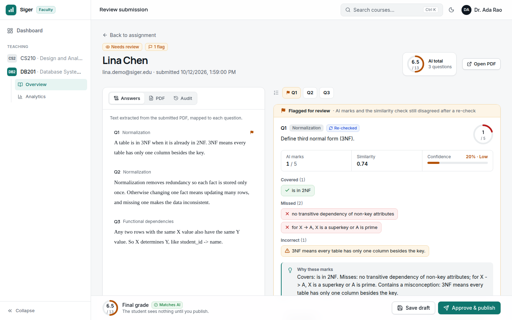
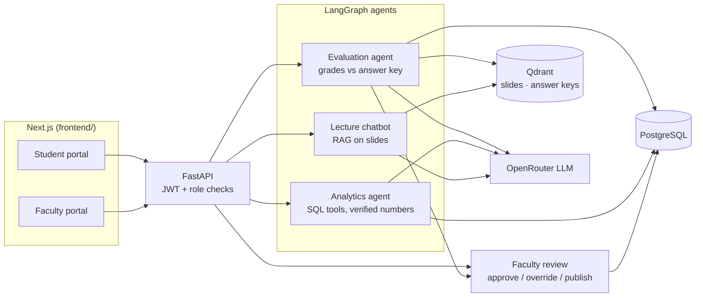
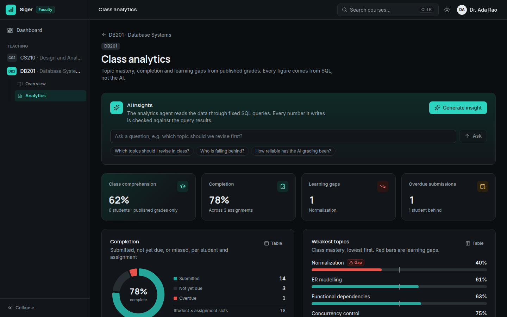
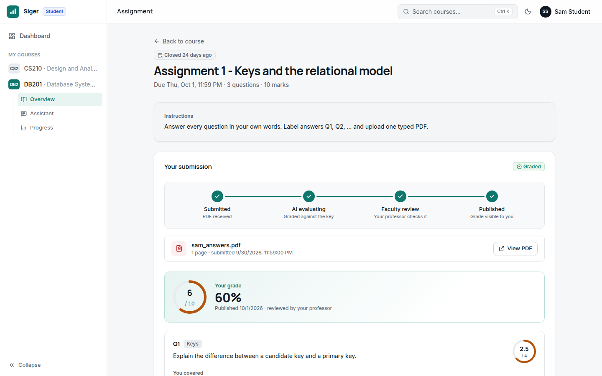

# SIGER

Agentic AI academic assessment and learning-analytics platform.

Faculty create assignments with an answer key. An **evaluation agent** grades
student PDFs against it, question by question, with explainable feedback.
Faculty **approve or override** every grade before a student sees it.
Dashboards and an **analytics agent** show topic mastery, learning gaps and
progress, and a **lecture chatbot** answers questions from the course slides.

Built with Next.js, FastAPI, LangGraph, PostgreSQL, Qdrant and OpenRouter.



## How it works



| Agent | What it does |
|---|---|
| **Evaluation agent** | PDF → text → answers mapped to questions → each question scored in parallel by the LLM against the model answer, with embedding similarity as an independent check → one re-check on disagreement, then flagged → feedback pointing to lecture slides → saved for faculty review |
| **Analytics agent** | the LLM picks fixed, role-scoped SQL tools and explains the results; every number it writes is verified against the query results, or the answer is withheld |
| **Lecture chatbot** | retrieve from the slides → relevance check (no LLM call when off-topic) → grounded answer with page citations, or a polite refusal |

Full details, with diagrams of each agent, the data model and the API:
**[docs/architecture.md](docs/architecture.md)**.

| Class analytics (dark mode) | Student's published grade |
|---|---|
|  |  |

## Run it locally

Needs Docker, Python 3.12 with [uv](https://docs.astral.sh/uv/), and Node 20.9+.

```bash
docker compose up -d                       # PostgreSQL (port 5433) + Qdrant (6333)

cd backend
cp .env.example .env                       # then set JWT_SECRET_KEY and OPENROUTER_API_KEY
uv sync
uv run alembic upgrade head
uv run uvicorn app.main:app --reload       # API on http://localhost:8000 (docs at /docs)

cd ../frontend
npm install
npm run dev                                # app on http://localhost:3000
```

The frontend forwards `/api/backend/*` to the API; set `BACKEND_API_URL` if
the API is not on `http://127.0.0.1:8000`.

## Demo data

```bash
cd backend
uv run python -m scripts.seed_demo         # --remove deletes it all again
```

Creates a professor, six students and the course DB201 with three
assignments: graded and published work, a learning gap, an at-risk student,
a missed deadline and two submissions waiting for review. Grades are
generated without any LLM calls. Every demo account uses the password
`SigerDemo123`:

| Account | Role | Try |
|---|---|---|
| `prof.demo@siger.edu` | faculty | class analytics and the two submissions waiting for review |
| `student.demo@siger.edu` | student (Sam) | progress page; Assignment 3 is open: submit `backend/demo_data/sam_assignment3_answers.pdf` to watch the agent grade it live |

Only embedding the course notes uses the AI provider; if that step is
skipped (quota), run the seed again later. Deadlines are relative to when you
seed, so re-seed before a demo.

## Live AI check

With the API running and the demo data seeded:

```bash
cd backend
uv run python -m scripts.smoke_ai
```

Submits Sam's answers, waits for the AI grade, publishes it, and asks the
analytics agent and the chatbot one question each (about 12 provider requests).

## Tests

```bash
cd backend && uv run pytest                # 93 tests; needs PostgreSQL; LLM and Qdrant are faked
cd frontend && npm run lint && npm run build
```

## Free-tier notes

The default models are OpenRouter's free models
(`nvidia/nemotron-3-ultra-550b-a55b:free` for chat,
`nvidia/nemotron-3-embed-1b:free` for embeddings), which share a daily limit
of about 50 requests. To stay within it:

- grading uses one LLM call per question plus one for feedback; clearly
  labelled answers (Q1, Q2…) need no extra call to map them to questions;
- the chatbot refuses off-topic questions without an LLM call;
- AI insights are generated only when asked for, never on page load.

When the limit is reached the app says so and when it resets; failed
gradings can be retried from the submission page.

## Repository layout

```
.
├── backend/              FastAPI app, LangGraph agents, migrations, tests, demo scripts
│   ├── app/agents/       evaluation/, analytics/, chat/  (the three LangGraph graphs)
│   ├── app/services/     business logic and all SQL analytics
│   ├── app/api/routes/   HTTP endpoints
│   └── tests/            pytest suite
├── frontend/             Next.js app (student and faculty portals)
│   ├── app/              pages (App Router)
│   ├── components/ui/    design system
│   └── lib/api.ts        typed client for every backend endpoint
├── docs/                 architecture, design decisions, failure modes, reading guide
└── docker-compose.yml    PostgreSQL + Qdrant for local development
```

## Documentation

| Document | Read it to… |
|---|---|
| [docs/architecture.md](docs/architecture.md) | understand how everything fits: agents, data model, security, API, frontend |
| [docs/DDR.md](docs/DDR.md) | know why it was built this way (design decisions and trade-offs) |
| [docs/FAILURES.md](docs/FAILURES.md) | see what can go wrong, how it's handled, and known limitations |
| [docs/LEARNING.md](docs/LEARNING.md) | get a guided reading path through the code |
| [docs/design/SIGER_Revised_Architecture.pdf](docs/design/SIGER_Revised_Architecture.pdf) | read the design plan the build followed (written before implementation) |
| [frontend/README.md](frontend/README.md) | work on the web app |

## License

[MIT](LICENSE)
